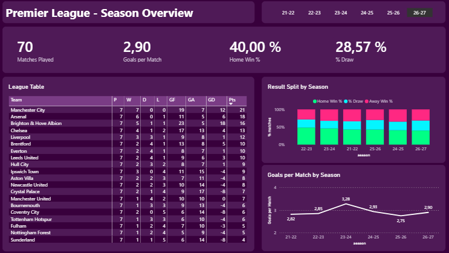
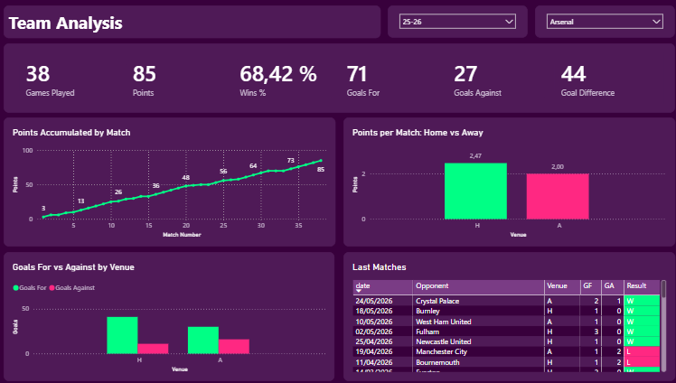
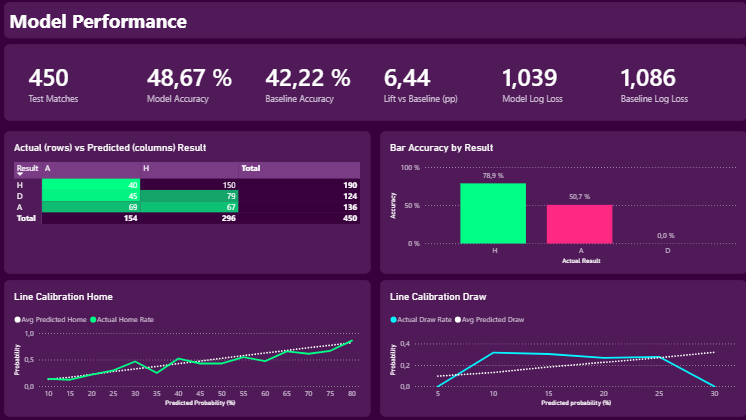
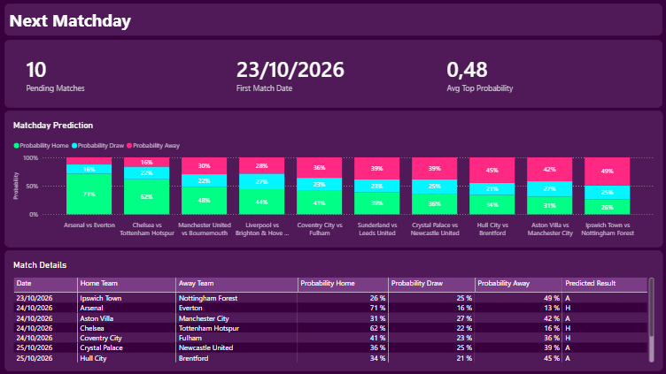

# Premier League Predictor

End-to-end pipeline that predicts Premier League match outcomes (home win / draw / away win), validated honestly over time and delivered as a Power BI dashboard with the probabilities for the next matchday.

## Problem Statement

Predicting football results is hard: even the best public models top out around 50-55% accuracy, and the draw is almost impossible to anticipate. Most beginner projects hide this behind inflated metrics caused by **data leakage** (using information from after the match) or by random train/test splits that let the model "see the future".

This project asks a more honest question:

> *Can a model that only uses information available before kickoff beat a naive baseline, and are its probabilities trustworthy?*

## Description

Football Match Predictor combines two public data sources: historical Premier League seasons (2021-22 to 2025-26) from the [DataHub English Premier League dataset](https://datahub.io/football/english-premier-league), and the current season (played and upcoming matches) from the football-data.org API. It cleans and unifies them, builds features that use **only past matches**, trains and compares several multiclass classifiers with a **temporal split**, and exports the results to a Power BI dashboard.

The project is evaluated with **log loss**, accuracy and probability calibration, and compared against baselines (class priors, logistic regression). A prediction log, frozen before each matchday and scored afterwards, tracks real out-of-sample performance over time.

**Current results** (Premier League, temporal split, run of 20/10/2026):

| Model | Log loss (val) | Log loss (test) | Accuracy (test) |
|---|---|---|---|
| Dummy (class priors) | 1.0826 | 1.0887 | 41.97% |
| **Random Forest (selected)** | **0.9972** | **1.0421** | **48.62%** |

The selected model beats the baseline by roughly 6-7 percentage points of accuracy. Calibration error (ECE) on test: Home 0.036, Draw 0.076, Away 0.042. The test set is "live" and grows every week, so these numbers change as new matches are played.

> **Honest takeaway:** the model adds a modest but real edge over the baseline. It does not "solve" football, and it has almost no skill predicting draws. See [Lessons Learned](#lessons-learned).

## Features

- **Two-source ingestion**: historical seasons from DataHub CSVs, and the current season from football-data.org with rate limiting, retries and raw JSON cached on disk (re-running the script costs no extra API requests).
- **Clean, documented dataset**: one row per match, handling of postponed/unplayed matches, consistent team names and a data dictionary.
- **Leakage-safe feature engineering**: recent form, goals for/against, home/away form, rest days, custom Elo rating, head-to-head, plus optional feature groups (season start, table level, draw tendency, opponent quality, Elo trend, calendar congestion).
- **Leakage check**: a perturbation test that alters one match and verifies that no earlier feature changes.
- **Model comparison** with automatic selection of the best non-dummy model by validation log loss.
- **Calibration analysis** per class (reliability curves and ECE).
- **Prediction tracking**: frozen predictions are logged before each matchday and scored once results are in.
- **Daily automation** with GitHub Actions to refresh data.
- **4-page Power BI dashboard**: League Overview, Team Analysis, Model Performance and Next Matchday.


## Technologies

| Category | Tool | Purpose |
|---|---|---|
| Language | Python 3.10+ | Ingestion, cleaning, features, modeling |
| Data | pandas, numpy | Data manipulation |
| Data (history) | DataHub EPL dataset (CSV) | Historical match results and statistics, 2021-22 to 2025-26 |
| Data (current season) | football-data.org API | Played and upcoming matches |
| API client | requests | Consuming football-data.org |
| Modeling | scikit-learn, XGBoost | Baselines, Random Forest, XGBoost, metrics, calibration |
| Visualization (Python) | matplotlib | Calibration and diagnostic plots |
| BI | Power BI Desktop, DAX, Power Query | Data model, measures, dashboard |
| Automation | GitHub Actions | Daily data refresh |
| Version control | Git, GitHub | Code and documentation hosting |

Everything used is free and publicly available.

## Key Technical Decisions

- **Temporal split instead of random split.** Train on the past, validate and test on the future. A random split would leak information and inflate metrics.
- **Features computed only from previous matches.** Each match's features use data strictly before its date, enforced with a leakage check.
- **Log loss as the primary metric.** It evaluates the quality of the probabilities, not only the predicted class, which matters because the dashboard shows probabilities.
- **Baselines first.** A dummy model (class priors) and logistic regression set the bar that the final model must clear.
- **Automatic model selection on validation.** The best non-dummy model by validation log loss is chosen (Random Forest won over logistic regression and regularized XGBoost). The test set is never used for selection.
- **Own Elo rating.** Built from scratch from match results to avoid external data and keep full control over what information is used.
- **Historical data from DataHub, current season from the API.** The free football-data.org plan does not cover enough history, so past seasons come from the DataHub dataset (public domain license) and the API is used only for the current season and upcoming fixtures.
- **Raw data cached on disk.** Respects the free-plan rate limit (~10 requests/minute) and makes the pipeline reproducible.
- **Prediction log keyed by season + home team + away team.** `match_id` can change when a match is rescheduled, so it is not a safe key for tracking.
- **Power BI data model.** Fact table of matches, `Dim_Date` built with `CALENDAR()` (not `TODAY()`) so pending matches stay inside the date range, and a `TeamMatches` table (one row per team per match) for team-level analysis.


## Challenges & Solutions

| Challenge | Solution |
|---|---|
| Free API plan limits history and requests (~10/min) | Pauses and retries between calls, raw JSON cached on disk, scripts safe to re-run |
| Free API plan does not provide enough historical seasons | Historical seasons downloaded from the DataHub EPL dataset; the API covers only the current season |
| Programmatic download of the historical CSVs timed out | Files downloaded manually from DataHub and stored in `data/raw/` (documented in Installation) |
| Two sources with different formats and team names | Both are flattened to the same one-row-per-match schema, with consistent team names, in the cleaning step |
| Data leakage risk in rolling features | Features built chronologically from past matches only, plus a perturbation-based leakage check |
| Draws are almost unpredictable | Reported honestly instead of forcing the metric; per-class calibration shows where the model has no signal |
| `match_id` changes when matches are rescheduled | Prediction log keyed by season + home team + away team |
| Pending matches fell outside `Dim_Date` in Power BI | Replaced `TODAY()` with a fixed `CALENDAR()` range covering future fixtures |
| Keeping the dashboard in sync with a new model | Rebuilt the export (`p_home`, `p_draw`, `p_away`, `pred_result`) and merged predictions by `match_id` in Power Query |


## Lessons Learned

- **Football has a low accuracy ceiling.** A few points over the baseline is a real result, not a failure.
- **Draws carry almost no signal** with match-result features alone; the model rarely predicts them and is least reliable there.
- **A more complex model is not automatically better.** Random Forest and logistic regression ended up close to XGBoost on log loss; validation, not intuition, decided.
- **Calibration matters as much as accuracy** when probabilities are shown to end users.
- **Freezing predictions before the matches** is the only way to prove there is no look-ahead; the prediction log makes the evaluation auditable.
- **Small test sets are noisy.** With a few hundred matches, differences of one or two points are within the margin of error.


## Installation

```bash
# 1. Clone the repository
git clone https://github.com/simobote0355/premier-league-predictor
cd premier-league-predictor

# 2. Create and activate a virtual environment
python -m venv venv
source venv/bin/activate        # Windows: venv\Scripts\activate

# 3. Install dependencies
pip install -r requirements.txt
```

**Historical data (manual step).** Download the season CSVs for 2021-22 to 2025-26 from the [DataHub English Premier League dataset](https://datahub.io/football/english-premier-league) (files `season-2122.csv` to `season-2526.csv`) and place them in `data/raw/`. The current season is downloaded by the ingestion script from the API.

To open the dashboard you also need [Power BI Desktop](https://powerbi.microsoft.com/desktop/) (free, Windows).


## Environment Variables

Get a free token at [football-data.org](https://www.football-data.org/client/register) and create a `.env` file based on `.env.example`:

```env
FOOTBALL_DATA_TOKEN=your_api_token_here
```

| Variable | Description |
|---|---|
| `FOOTBALL_DATA_TOKEN` | API key for football-data.org (free plan). Also used as a GitHub Actions secret for the daily refresh. |


## Usage

Run the pipeline in order from the project root:

```bash
python src/ingest_api.py          # 1. Download current-season data from the API (cached in data/raw)
                                  #    (historical CSVs must already be in data/raw, see Installation)
python src/clean.py               # 3. Build the clean matches table
python src/features.py            # 4. Build leakage-safe features
python src/model.py               # 6. Train, compare, evaluate and export CSVs for Power BI
```

Track real predictions before and after each matchday:

```bash
python src/track_predictions.py log     # Freeze predictions for upcoming matches
python src/track_predictions.py score   # Score logged predictions against real results
```

Then open the Power BI file and refresh the data from the exported CSVs in the `powerbi/` folder.


## Project Structure

```
football-match-predictor/
├── .github/workflows/        # GitHub Actions (daily data refresh)
├── data/
│   ├── raw/                  # DataHub season CSVs + cached API responses (JSON)
│   ├── processed/            # Clean matches, features, predictions_log.csv
│   └──powerbi/               # CSVs exported for Power BI (+ .pbix)
│      dashboard/
├── docs/
│   ├── data_dictionary.md    # Column definitions
│   └── images/               # Dashboard screenshots
├── src/
│   ├── config.py             # Paths, season, constants
│   ├── ingest_api.py         # API ingestion with rate limiting and retries
│   ├── clean.py              # Cleaning and flattening
│   ├── features.py           # Feature engineering (USE_GROUPS toggles feature groups)
│   ├── model.py              # Baselines, models, metrics, calibration, export
│   └── track_predictions.py  # Prediction log (log / score)
├── .env.example
├── requirements.txt
└── README.md
```

## Screenshots

**League Overview**



**Team Analysis**



**Model Performance**



**Next Matchday**




## API

### Current season: football-data.org

Played and upcoming matches of the current season come from the [football-data.org](https://www.football-data.org/) v4 API (free plan, around 10 requests per minute).

- **Base URL:** `https://api.football-data.org/v4`
- **Authentication:** `X-Auth-Token` header with your token
- **Main endpoint used:** `GET /competitions/PL/matches?season={year}` (finished and scheduled Premier League matches)

The ingestion script spaces out requests, retries on failure and stores each response in `data/raw/`, so it is safe to run multiple times without consuming extra requests.

### Historical seasons: DataHub

Past seasons (2021-22 to 2025-26) come from the [DataHub English Premier League dataset](https://datahub.io/football/english-premier-league), one CSV per season (`season-YYYY.csv`). It includes full-time and half-time results plus match statistics (shots, corners, fouls, cards, referee). The data originates from [football-data.co.uk](http://www.football-data.co.uk/) and is released under the Open Data Commons Public Domain Dedication and License (ODC-PDDL 1.0).

## Future Work

- Compare model probabilities against bookmaker odds (log loss) as an external benchmark.
- Walk-forward validation, bootstrap confidence intervals for the lift over the baseline, and a paired test between models.
- Shot-based features and a Poisson / Dixon-Coles goal model (the DataHub CSVs already include shots and shots on target for these seasons; the current-season API data does not).
- Probability calibration (isotonic or Platt scaling).
- Add a `matchday` column and a fifth dashboard page to track live predictions over time.

## Autor

Simón — Data Analyst / Data Engineer transitioning into ML-adjacent roles, with a background in BigQuery, PySpark, and AWS (S3, Glue, Athena). This project was built as a hands-on introduction to RAG and NLP pipelines.

- GitHub: [@simobote0355](https://github.com/simobote0355)
- LinkedIn: [Simón Botero](https://www.linkedin.com/in/simon-botero-ingenieria-sistemas/)

## License

This project is licensed under the [MIT License](LICENSE).

**Data attribution:**

- Historical data: [DataHub English Premier League dataset](https://datahub.io/football/english-premier-league), derived from [football-data.co.uk](http://www.football-data.co.uk/), under ODC-PDDL 1.0. It is intended for educational and research purposes; review the original site's terms for other uses.
- Current-season data: [football-data.org](https://www.football-data.org/), under their terms of use.

This repository is for educational and portfolio purposes.